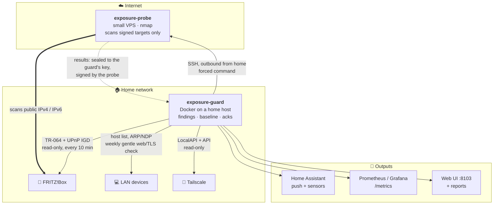

<div align="center">

# 🛡️ Exposure Guard

**Know what your home network exposes to the internet, before someone else does.**

Watches port forwardings (especially the ones devices open themselves via UPnP), scans your own public IPv4/IPv6
from outside and reports security-relevant changes in the LAN and tailnet.

[](LICENSE)


[How it works](#how-it-works) · [Alerts](#severities-and-alerts) · [Install](#installation) ·
[Secrets](#secrets) · [Commands](#commands) · [Deutsch](README.de.md)

</div>

---

## What it watches

| | Area | What is checked |
|---|---|---|
| 📡 | **FRITZ!Box** (TR-064 + UPnP IGD, read-only) | every port forwarding, **manual vs. UPnP**, with device and first-seen time; UPnP status, remote access, MyFRITZ!, provider management, firmware |
| 🌍 | **External view** (probe on a small VPS) | your public IPv4 and every global IPv6 address in the LAN, scanned from the internet: top ports daily, all TCP ports weekly, service/version detection, TLS. A newly forwarded port triggers an immediate scan, so it is verified from outside within minutes. Results come back **sealed and signed** (libsodium) |
| 🔁 | **IP changes** | public IPv4 and IPv6 prefix, router view cross-checked with what the probe sees |
| 🏠 | **LAN inventory** (passive) | new unknown devices with MAC, vendor, hostname |
| 🔍 | **LAN web check** (weekly, gentle) | plain-HTTP logins, products with known default logins or no authentication (start page only, **never a login attempt**), TLS certificates |
| 🔐 | **Tailscale** | nodes, key expiry, exit nodes, subnet routes; ACL/policy check with a read-only OAuth client |
| 🩺 | **Itself** | a failed check or an unreachable/stale probe is reported: a missing scan never looks like "all clear" |

Alerts go to a Home Assistant notify service, plus status sensors in Home Assistant, Prometheus metrics, a Grafana
dashboard and an initial + weekly report with an assessment and a concrete action per finding.

> [!IMPORTANT]
> **It never changes anything** on the router, firewall or devices. It reports and recommends.
> Router access is limited to `Get*` actions, enforced in code.

## How it works



- **No inbound port at home.** The guard connects out to the probe over SSH; the probe's key may only run a fixed gate
  (`health`, `put-targets`, `get-results`, `scan-now`).
- **The probe never enters the LAN or the tailnet.** It only scans target lists signed by the guard and refuses any
  non-global address.
- **Results are useless on the VPS.** They are encrypted to the guard's key and only accepted when signed with the
  probe's pinned key.

## Severities and alerts

| Severity | Examples | Delivery |
|---|---|---|
| 🔴 **critical** | new port reachable from the internet, new UPnP/manual forwarding, IPv6 device directly reachable, unknown LAN or tailnet device | **immediately** (push) |
| 🟠 **high · medium · low · info** | UPnP enabled, remote access, TLS problems, plain-HTTP logins, default-login products, key expiry, ACL allow-all, firmware | weekly report with assessment + action |
| 🩺 **health** | a check fails, probe unreachable, external view older than `stale_hours`, IP mismatch | **immediately**, plus recovery message |

> [!NOTE]
> On the first run everything found becomes the **baseline** (no alerts, listed in the initial report for review).
> Afterwards only changes alert. An alert repeats only when the finding changes again.

### Acknowledging

```bash
exposure-guard findings                       # ids
exposure-guard ack 'map:tcp/32400' "Plex, wanted"
exposure-guard ack 'device:aa:bb:cc:dd:ee:ff' "new tablet" --until 2027-01-01
exposure-guard unack 'map:tcp/32400'
```

Or edit `acks/acks.yaml` (wildcards allowed). An acknowledgement is bound to the state it was given for
(fingerprint): when the finding changes (different device, service, origin ...) it alerts again.

## Installation

### 1. Guard (home host with Docker)

```bash
git clone https://github.com/Zedas030/exposure-guard && cd exposure-guard
sudo ./scripts/install.sh            # installs to /opt/exposure-guard, builds and starts the container
sudoedit /opt/exposure-guard/config/config.yaml
sudoedit /opt/exposure-guard/.env    # secrets, see below
cd /opt/exposure-guard && sudo docker compose up -d --force-recreate
```

The installer prints the values needed for the probe: the guard's SSH public key and its two public crypto keys
(`exposure-guard keys` shows them again).

### 2. External probe (VPS)

Any small VPS with a public IPv4 **and IPv6** works (1 vCPU, 512 MB are plenty). Debian 12/13.

```bash
scp -r probe root@203.0.113.20:/root/
ssh root@203.0.113.20 'cd /root/probe && GUARD_SSH_PUBKEY="ssh-ed25519 AAAA... exposure-guard" \
  GUARD_VERIFY_KEY="..." GUARD_BOX_KEY="..." bash install-probe.sh'
```

The script installs nmap and python3-nacl, a user `probe` whose only SSH key may run the gate (forced command,
`restrict`), the scan timer (05:00 daily, all TCP ports on Saturdays), nftables (only SSH inbound), key-only sshd and
unattended upgrades. It prints `PROBE_VERIFY_KEY=...` - put it into `external.probe_verify_key` and pin the host key:

```bash
sudo sh -c 'ssh-keyscan -t ed25519 203.0.113.20 >> /opt/exposure-guard/data/ssh/known_hosts'
exposure-guard run external
```

### 3. Home Assistant

- Long-lived access token -> `HA_TOKEN` in `.env`; notify service -> `homeassistant.notify_service`.
- Import `ha/automation.yaml` (dead man's switch: alerts when the guard itself stops reporting).
- Sensors (created by the guard): `sensor.exposure_guard` (ok / attention / degraded / unknown / alert),
  `sensor.exposure_guard_external`, `sensor.exposure_guard_open_findings`, `sensor.exposure_guard_last_external_scan`.

### 4. Prometheus / Grafana

```yaml
  - job_name: exposure_guard
    scrape_interval: 60s
    static_configs:
      - targets: ['localhost:8103']
```

Dashboard: `grafana/exposure-guard.json` (uid `exposure-guard`).

## Secrets

> [!TIP]
> All secrets live in **`/opt/exposure-guard/.env`** (mode 600, owned by root, read only by Docker Compose).
> `config.yaml` only contains the *names* of the variables. Template: [.env.example](.env.example).

Enter or rotate them with `sudo nano /opt/exposure-guard/.env` or interactively (hidden input) with
`sudo /opt/exposure-guard/scripts/set-secrets.sh`; afterwards `docker compose up -d --force-recreate`.

| Variable | What | How to create / rotate |
|---|---|---|
| `FRITZ_USER`, `FRITZ_PASSWORD` | dedicated FRITZ!Box user | FRITZ!Box > System > FRITZ!Box Users > Add user. Right **"FRITZ!Box settings" only** (TR-064 refuses port-mapping/remote-access queries without it; AVM has no read-only role). Untick "Access from the internet allowed". Rotate: change the password there, update `.env`, `docker compose up -d --force-recreate`. |
| `HA_TOKEN` | Home Assistant long-lived access token | HA profile > Security > Long-lived access tokens. Rotate: create a new one, update `.env`, recreate, delete the old one. |
| `TS_OAUTH_CLIENT_ID`, `TS_OAUTH_CLIENT_SECRET` | Tailscale OAuth client (optional) | Admin console > Settings > OAuth clients, scopes **`policy_file:read` and `devices:core:read`** (read only). Rotate: create a new client, update `.env`, revoke the old one. |

<details>
<summary><b>Key material created by the tool</b> (no manual handling needed)</summary>

| File | Purpose | Rotation |
|---|---|---|
| `data/ssh/id_ed25519` | SSH key of the guard for the probe | delete it, re-run `install.sh`, put the new public key into the probe's `install-probe.sh` call |
| `data/keys/guard_sign.key`, `guard_box.key` | signs target lists / decrypts results | delete both, restart the container, re-run `install-probe.sh` with the new `exposure-guard keys` values |
| probe: `/etc/exposure-probe/probe_sign.key` | signs results | delete it, re-run `install-probe.sh`, update `external.probe_verify_key` |

</details>

## Configuration

`config/config.yaml` is fully commented ([example](config/config.example.yaml)). Main switches: LAN range, router
address, probe host, scan rates, LAN web check weekday/time and exclusions, Tailscale, Home Assistant, schedule.

## Commands

| Command | What it does |
|---|---|
| `exposure-guard status [--json]` | overall state + health of every check |
| `exposure-guard findings [--all] [-v] [--severity medium]` | list findings |
| `exposure-guard ack <id> "reason" [--until YYYY-MM-DD]` | acknowledge a finding (`unack <id>`, `acks` to list) |
| `exposure-guard run local\|external\|lan-web\|tailscale\|all` | run checks now |
| `exposure-guard report initial\|weekly [--notify]` | build a report |
| `exposure-guard scan-now` | send the current targets and ask the probe for an immediate daily scan (max. once per hour) |
| `exposure-guard keys` · `test-notify` | show public keys · send a test alert |

## Safety and scope

- 🎯 **Targets:** only the router's own public addresses and global IPv6 addresses observed in the own LAN. The probe
  refuses any target list that is not signed by the guard and any non-global address.
- 🐢 **LAN:** no SYN or version scans against IoT devices; one TCP connect scan per week at `-T2` with a packet-rate cap
  on a short list of web ports, then one GET of each start page and at most three TLS handshakes. No credentials are sent.
- 📡 **Router:** only `Get*` actions (enforced in code).
- 📦 **Container:** unprivileged user, all capabilities dropped, read-only root filesystem, 256 MB / 0.5 CPU,
  log rotation (3 x 10 MB), restart `unless-stopped`.

## Tests

```bash
docker build --target test -t exposure-guard:test . && docker run --rm exposure-guard:test   # unit tests
python3 tests/e2e/run_e2e.py                                                                 # end-to-end (Docker)
```

The end-to-end test starts the real guard container and the real probe (installed by `install-probe.sh`, SSH,
sealed results, nmap) against a fake router, a fake Home Assistant and a target host, and checks baseline, UPnP
forwarding -> internal and external alert, new device, LAN web check, acknowledge/re-alert, probe outage -> warning and
state `unknown`, recovery, no write action on the router.

## Uninstall

```bash
cd /opt/exposure-guard && sudo docker compose down && sudo rm -rf /opt/exposure-guard /usr/local/bin/exposure-guard
```

On the VPS: `systemctl disable --now exposure-probe-scan.timer exposure-probe-request.path`, `userdel -r probe`,
`rm -rf /opt/exposure-probe /etc/exposure-probe` - or simply delete the VPS.

## License

[MIT](LICENSE)
